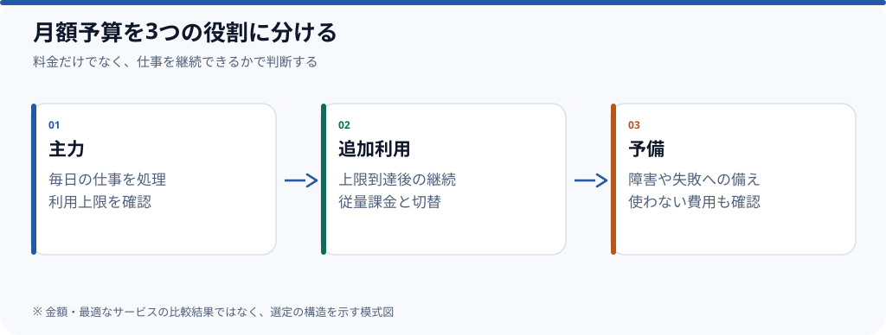

# 月額100ドルのAI駆動開発、何に予算を配分するか

**毎日AIを使って開発するなら、月額100ドルを最初から複数の定額契約で埋めず、主力の環境と超過時の逃げ道を別々に確保する構成から検証する。** これは現時点の*選定方針*であり、個別プランの最新価格・性能・実際の利用上限を比較し終えた結論ではない。

一見安く見える定額プランでも、週の前半に利用上限へ到達するなら作業を続けるための追加費用や待ち時間が必要になる。一方、従量課金だけで運用すると支出は作業量に比例しやすい。判断するのは**月額料金ではなく、1か月の仕事を完了できる構成**だ。

## まず分けて考える

| 費用 | 判断したいこと | 確認するもの |
| --- | --- | --- |
| **主力** | 毎日使うタスクで安定して作業できるか | 日々の上限、モデルの制約、IDE/CLI連携 |
| **追加利用** | 上限到達後も処理を続けられるか | 従量単価、予算上限、モデル互換性 |
| **予備** | 主力の障害・失敗で仕事を止めないか | 代替経路、環境切替の操作コスト |

例えば固定契約を増やしても、認証設定やコンテキスト引継ぎに毎回時間がかかれば、額面どおりの効率は得られない。**単一のプロバイダに集約すること**と**複数を並列運用すること**のどちらがよいかは、作業実績から判断する。

## 値段以外に記録すべき5項目

1. **どんなタスクか**：新規実装、既存コードの修正、調査、レビュー。
2. **実際に完了したか**：動作確認と差分のレビューが済んだか。
3. **人間の介入回数**：指示し直し、ログ確認、手戻りの頻度。
4. **止まった理由**：利用上限、レスポンス遅延、誤変更、認証の問題。
5. **支出**：固定契約、追加API料金、未使用の契約。

速度だけを比べると、失敗後の修正時間が隠れる。試行ごとに**完了・追加作業・費用**をそろえて記録したい。

## いつ結論が変わるか

同じ主力が大半のタスクを片付けるなら単一サブスクが単純だ。異なる仕事を並行して処理でき、設定と監督の負荷が小さいなら複数契約が有利になり得る。月末にしか上限へ達しないなら、予備の定額より必要時の従量課金が適切な場合がある。

**公開前に残る検証**：2026年10月時点の候補プランの公式料金・上限、実際の月間利用量、モデル別に同じ仕事を実行した結果。根拠が揃うまでは特定の製品を「最適」と呼ばない。

*制作状況：草稿。推奨構成の実証・最新料金の検証は未完了。関連Issue：[#2](https://github.com/rebuildup/ai-knowledge/issues/2)。*
