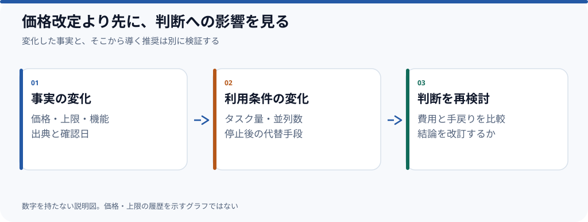

# AIツールの価格と利用上限をどう評価するか

**AI開発ツールを選ぶ際、月額料金より先に確認したいのは「作業が止まる条件」と「止まった後に何ができるか」だ。** 2026年10月時点の著者の判断を整理する草稿であり、市場全体の統計的な結論ではない。

## なぜ月額料金だけでは決められないのか

同じ金額でも、利用制限の計算方法・モデルの種類・同時実行・追加課金の条件はサービスによって違う。しかも開発タスクは、短い質問と長時間の実装とで必要な処理量が大きく変わる。

例えば「毎日少しずつ質問する」人と「複数のエージェントを並行して動かす」人では、同じ定額契約の価値が異なる。**安さの比較は、利用形態をそろえて初めて意味を持つ**。

## 変動する情報と、変わりにくい判断を分ける

| 変動する事実 | 比較のために残す条件 |
| --- | --- |
| 月額料金・追加単価 | 対象地域、税、課金単位、確認日 |
| 利用上限 | 期間、リセット、並列実行時の扱い |
| 提供モデル | 利用可能な機能、品質・速度の評価条件 |
| API・アプリの提供範囲 | 対応OS、CLI、IDE、自動化の方法 |

価格や上限の正本は、複数の記事に同じ値を使う段階で[共通データの管理](../../docs/根拠と更新.md)にまとめる。**データが更新されても、おすすめの結論が自動的に正しくなるわけではない**。

## 誰にとっての「良い選択」か

- **軽い利用が中心**なら、使わない機能に毎月払う必要は小さい。
- **長時間の連続作業が中心**なら、停止条件・復帰方法・追加利用料金が重要になる。
- **複数の作業を並行する**なら、上限だけでなく監督と統合のコストも比較する。
- **仕事で再現性が重要**なら、モデルの切替・仕様変更時の影響を追えることを重視する。

ここで言う「重要」は判断基準の提案であり、どのプランが最安かという実測値ではない。

## 将来この見解をどう検証するか

後から料金体系が変わったとしても、この記事の**2026年10月時点の主張**は書き換えず、検証結果を追記して区別する。一方、最新の比較表を提供する記事は別途「継続更新」とし、公式価格・上限を確認してから公開する。

**公開前の確認事項**：実際の料金・上限改定の具体例、その公式出典、著者が経験した停止や代替手段の記録。これらを追加して、一般論だけで終わらない記事にする。

*制作状況：時点固定の見解草稿。変更履歴・公式価格の確認は未完了。関連Issue：[#6](https://github.com/rebuildup/ai-knowledge/issues/6)。*
