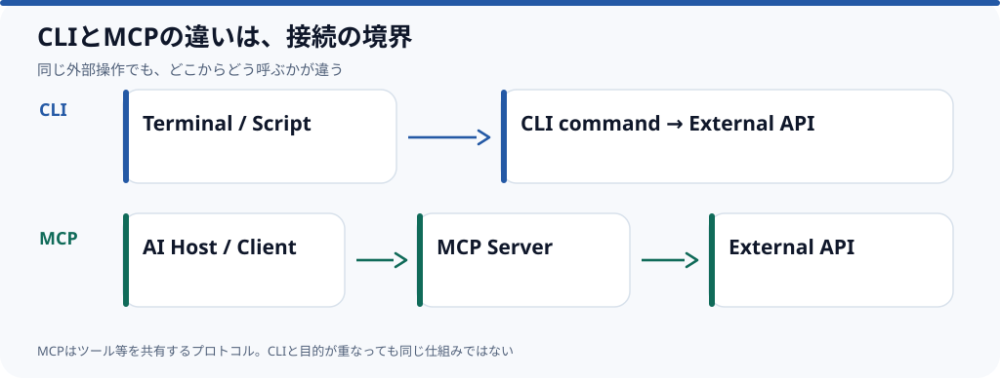

# MCPとCLIはどう使い分けるべきか

**人間や既存の自動化から定型操作を呼ぶだけならCLIで十分で、AIアプリに外部ツールの発見・入力形式・実行結果を共通の仕組みとして渡したいならMCPが候補になる。** MCPはCLIの上位互換ではなく、接続する側と操作する側の**境界の定義**が違う。



## 違いはコマンドの機能ではない

CLIはコマンドラインからプログラムを呼び出す操作方法だ。例えば[GitHub CLIの公式資料](https://docs.github.com/en/github-cli)は、IssueやPRなどを端末から操作するためのコマンドを説明する。

MCPはAIアプリが外部のツール・リソース・プロンプトを利用するためのプロトコルだ。現行の[公式アーキテクチャ資料](https://github.com/modelcontextprotocol/modelcontextprotocol/blob/main/docs/docs/2026-07-28/learn/architecture.mdx)では、AIアプリであるHostがClientを介してServerに接続し、Serverが機能を公開する。

このため、同じAPI操作でも**CLIから呼ぶ実装**と**MCPサーバーとして公開する実装**の両方が成立する。

## まずCLIでよいケース

- コマンドがすでに存在し、人が動作や結果を確認できる。
- シェルスクリプト、CI、定型の自動化から再利用する。
- ローカルのプロセスに、過不足なく権限を渡せる。
- AIへの「利用可能な操作の一覧」の公開が不要である。

```bash
gh pr list
gh issue list
```

上のコマンドは**操作例**であって、この草稿の作成中に特定のリポジトリで実行した結果ではない。

## MCPを検討するケース

- 異なるAIアプリから同じツールの定義を発見・利用したい。
- 引数・結果の形式を明示し、アプリ側から呼び出したい。
- リモートサービスやコンテキストの受渡しを接続方式として扱いたい。
- ツールに渡す権限・認可・監査を設計対象として明確にしたい。

ただし「MCPを使えば安全になる」わけではない。接続先への権限、サーバーができる操作、実行前確認、秘密情報の扱いは設計が必要だ。

## 迷ったときの選び方

| 問い | CLI | MCP |
| --- | --- | --- |
| 既存のコマンドをそのまま使えるか | そのまま利用しやすい | 別の接続境界が増える |
| AIアプリ間でツール仕様を共有したいか | アプリごとに呼出し方を決める | 共通プロトコルを使える |
| 検証しやすいか | 端末から単体実行しやすい | Client/Server接続も含む検証が必要 |
| 依存・運用負担 | 既存CLIの範囲に収まる | Serverと接続設定を保守する |

**おすすめの順序は「すでに使えるCLIがあるか → AIアプリ固有の統合が必要か → MCP追加に見合うか」**だ。アプリがCLIを直接呼べるなら、わざわざ両方を作る必要はない。

*資料確認：2026-10-18。実装条件やMCP仕様は変更され得る。実機の接続比較は未実施。関連Issue：[#5](https://github.com/rebuildup/ai-knowledge/issues/5)。*
