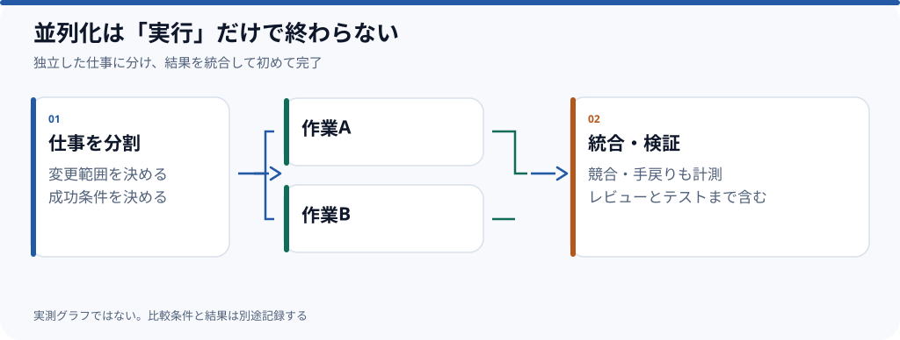

# 複数AIエージェントを並列実行するとき、何を測るべきか

**並列エージェントの効果を検証するなら、単なる実行時間ではなく、統合と手戻りを含む完了時間を測る必要がある。** この草稿では測定設計と公開済みの構成を整理する。**同じタスクを複数回実行した比較結果はまだ確認できておらず、高速化率は提示しない。**

## 何を同時に動かすか

並列化の単位は「モデル」ではなく**独立して検証できる仕事**がよい。例えば実装・調査・レビューを別々の作業として切るなら、互いの結果を比較できる。一方、同じファイルを複数のエージェントが書き換えると、統合衝突やレビュー負荷が増える。

| 観点 | 単一エージェント | 複数エージェント |
| --- | --- | --- |
| 所有する変更 | 1つの作業者が変更と判断を把握 | 作業単位と変更範囲の割当が必要 |
| 完了判定 | 変更・テスト・レビューを順番に確認 | 全タスクと統合後の動作確認が必要 |
| コスト | 単一のセッションと監督 | 複数の消費量と統合コスト |
| 失敗時 | 1つの作業をやり直す | 依存先と競合する仕事を再調整 |

複数セッションが動いていること自体は成果ではない。最終的な差分を統合し、テストで確認するまでを**完了**とする。

## 実際の環境から確認できること

公開されている[dotfilesの起動設計](https://github.com/rebuildup/dotfiles/blob/929ec8c03e31eeb07340aa1f2b9c396a7f653a92/docs/agent-launcher.md)では、`agent <harness> <provider>`という明示的なルートでエージェントを起動し、認証情報はプロセス単位で渡す。これは**エージェントを起動するための仕組み**であり、並列化による性能改善を実証する資料ではない。

実験の際はルートの違いだけでなく、タスク・入力・チェック条件も固定しないと比較が成立しない。

## 比較実験の設計

同じ規模の仕事を用意し、単独運用と並列運用を別条件で実行する。可能なら順番を入れ替え、偶然の失敗や通信状態に左右されないよう反復する。

| 記録 | 理由 |
| --- | --- |
| 開始・終了時刻 | 人間を含む総所要時間を算出する |
| タスク別の成功条件 | 「動いた」だけでなく完了判定をそろえる |
| 手戻り・レビュー・競合時間 | 並列実行に伴う隠れた負荷を数える |
| 消費量・実請求 | 効率をコストと一緒に評価する |
| 実行環境・モデル・入力 | 後から差の原因を追えるようにする |

**公開前に必要なもの**：実行ログ、比較対象のタスク、同条件の反復回数、集計した結果。数値を掲載するときはグラフの元データを`evidence/`へ残す。

*制作状況：実験設計の草稿。測定結果は未公開。関連Issue：[#3](https://github.com/rebuildup/ai-knowledge/issues/3)。*
