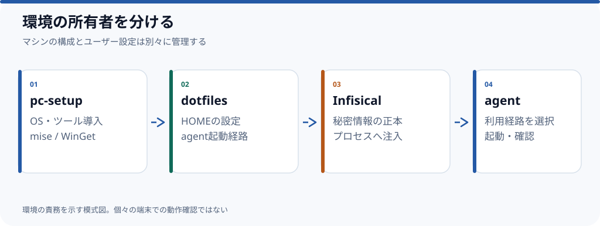

# miseとdotfilesでAIコーディング環境を再現する

**Ubuntu/WSLとmacOSでは、`pc-setup`でマシン側を用意し、`dotfiles`でユーザー設定とエージェント起動経路を整える構成にできる。** 以下は公開されている設定の読み解きであり、この記事の手順を新しい端末で最後まで実行した検証記録ではない。



## どのリポジトリが何を所有するか

| 役割 | 正本 | 変更する理由 |
| --- | --- | --- |
| マシンへのツール導入 | [pc-setup](https://github.com/rebuildup/pc-setup) | OS差、パッケージ導入、初期設定 |
| HOME配下のユーザー設定 | [dotfiles](https://github.com/rebuildup/dotfiles) | Git設定、エージェント起動、シークレット注入 |
| 秘密情報 | Infisical | 認証情報の登録・更新・ローテーション |

マシンの初期設定と、利用者が日常的に変更する設定を分離すると、環境差が生じても両方をまとめて書き換える必要が減る。ここでの分離は公開されている設定ファイルの責務から確認できる。

## 事前確認

- OSが対象のUbuntu/WSLまたはmacOSである。
- GitHub認証やInfisicalログインに必要な権限を持つ。
- 運用するリポジトリと導入スクリプトを**実行前に確認**する。
- 設定を上書きしないか、既存のdotfilesがある場合はバックアップ・衝突判定を確認する。

## 1. マシン側を用意する

[pc-setupのREADME](https://github.com/rebuildup/pc-setup/blob/783359624ad80dee80ae92d49de4f5ee12709241/README.md)には、UbuntuとmacOSで共有するブートストラップ入口が示されている。

```bash
curl -fsSL https://raw.githubusercontent.com/rebuildup/pc-setup/main/bootstrap.sh | bash
```

これは**公開元の手順の引用**であり、ここでは実行していない。ネットワーク上のスクリプトをシェルへ直接渡す方式なので、実運用では取得した内容・コミット・権限を確認してから実行する。環境ごとの差や詳細は[macOS用](https://github.com/rebuildup/pc-setup/tree/main/platforms/macos)、[Ubuntu/WSL用](https://github.com/rebuildup/pc-setup/tree/main/platforms/ubuntu-wsl)の資料を確認する。

## 2. ユーザー設定を読み込む

公開されている[dotfilesのREADME](https://github.com/rebuildup/dotfiles/blob/929ec8c03e31eeb07340aa1f2b9c396a7f653a92/README.md)では、`pc-setup`から`~/.dotfiles`への設定引継ぎを想定する。

新規導入後の確認例：

```bash
cd ~/.dotfiles
./script/check
./script/secrets-doctor
git submodule status --recursive
```

設定が見つかることと認証が成功することは別なので、**設定の検査と秘密情報へのアクセス確認を分ける**。

## 3. エージェントを起動する

`dotfiles`の`agent`ランチャーは、利用するハーネスとプロバイダを明示する方式を採る。例えば[公開ドキュメント](https://github.com/rebuildup/dotfiles/blob/929ec8c03e31eeb07340aa1f2b9c396a7f653a92/docs/agent-launcher.md)には次の使い方がある。

```bash
agent list
agent check
agent claude
```

`agent claude`のようにプロバイダを省略した場合はネイティブ起動経路になる。**プロバイダ名を省略した状態で勝手にAPIキーを切り替える方式ではない**。対応するルート、モデル、引数については当該文書を参照する。

## この手順だけでは確定できないこと

認証先のセットアップ、導入した実機のOSバージョン、GUIアプリの権限設定、使用プロバイダの課金状態は公開ソースだけでは保証できない。**新しい端末でのE2E実行とスクリーンショットの確認**が済むまでは、この記事を再現完了としない。

*制作状況：公開設定から作成した草稿。実機での手順検証は未実施。関連Issue：[#4](https://github.com/rebuildup/ai-knowledge/issues/4)。*
